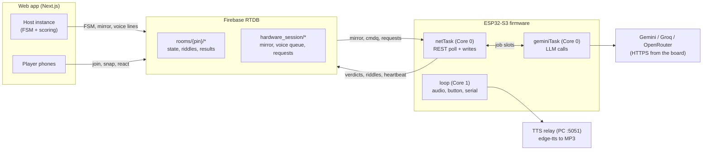

# SnapRiddle developer guide

SnapRiddle is one game spread over three programs that never talk to each other directly:

- **Web app** (`web_app/`, Next.js): the game master. It owns the state machine, scoring and all screens (host TV and player phones).
- **Firmware** (`ESP32/SnapRiddle_HW/`, Arduino C++ on a XIAO ESP32-S3 Sense): the camera, speaker and AI client. It writes riddles, judges photo proof and speaks.
- **TTS relay** (`tts_relay/`, FastAPI + edge-tts on the host PC): turns text from the board into an MP3 stream.

The only coupling between the web app and the board is a Firebase Realtime Database. Both sides read and write the same nodes.

The board polls `hardware_session` over REST every 600 ms during a live turn and every 1.5 s otherwise, on one TLS session it keeps open. Polling costs a little latency, but it needs no listener stack, survives network hiccups and keeps memory use predictable on a chip with 512 KB of SRAM.

## Repository layout

| Path | Contents |
| --- | --- |
| `ESP32/SnapRiddle_HW/` | Firmware sketch (open `SnapRiddle_HW.ino` in the Arduino IDE) |
| `ESP32/compiled_program.bin` | Prebuilt application image |
| `web_app/` | Next.js app (`src/` code, `public/` static files) |
| `tts_relay/` | Voice relay server |
| `Unit Tests/` | Hardware and cloud test sketches, see its README |
| `Documentation/` | This guide, user guide, installation, parameters, connection diagram |
| `.github/workflows/deploy-pages.yml` | Builds and deploys the web app to GitHub Pages |

## Firmware modules

The firmware is a single Arduino translation unit: `SnapRiddle_HW.ino` includes every header, and the include order matters.

| File | Role |
| --- | --- |
| `SnapRiddle_HW.ino` | Boot sequence and the Core 1 loop (audio, button, serial console) |
| `parameters.h` | Every hard-coded parameter, with a comment each |
| `SECRETS.h` | WiFi and API keys (template in the repo) |
| `cloud_link.h` | Firebase side: persistent TLS client, mirror parsing, voice queue, judge/riddle/hint pumps, heartbeat, WiFi recovery, retry slots for failed sends |
| `gemini_task.h` | The dedicated LLM task and its two job slots (judge, riddle) |
| `gemini_judge.h` | Frame capture to base64 and the vision verdict |
| `gemini_riddle.h` | Riddle generation prompt, reply parsing and validation, hint leak guard |
| `gemini_rotation.h` | Shared attempt wheel: model-first rotation, cooldowns, memory floors |
| `llm_provider.h` | OpenAI-compatible adapter for the Groq and OpenRouter fallbacks |
| `tls_psram.h` | Moves mbedTLS buffers to PSRAM; yielding TLS client; `[TLS]` diagnostics |
| `tts_engine.h` | Audio on Core 1: speak queue, offline queue, start/done echoes |
| `camera_srv.h` | Camera init and the local HTTP servers (:80 control, :81 stream) |
| `game_link.h` | Button dispatch rules and the serial console |
| `button_ctl.h`, `pins_board.h`, `shared_state.h` | Button gestures, camera pin map, cross-module flags |

### Tasks and cores

| Task | Core | Job |
| --- | --- | --- |
| `netTask` (priority 2) | 0 | Firebase polling and writes, judge/riddle/hint pumps, heartbeat |
| `geminiTask` (priority 1, stack in PSRAM) | 0 | Every LLM network call, one job at a time, judge before riddle |
| Arduino `loop()` | 1 | I2S audio decode, button scanning, serial console |
| httpd tasks | any | Camera stream, `/capture`, `/status`, `/settings`, `/speak` |

LLM calls can take up to 12 s per attempt, so they run on their own task: netTask hands over a job and polls for the result, which keeps polling, heartbeats and voice lines flowing while the board thinks. The tasks share data only through small mutex-guarded slots and mailboxes (`cloudMux`, `geminiMux`, `ttsMux`), never through a shared HTTP client or the Audio object.

## Web modules (`web_app/src/`)

| File | Role |
| --- | --- |
| `lib/types.ts` | Database contracts (Room, Player, CurrentRiddle, EvaluationResult, HardwareSession, ...). Change a node shape here and in the firmware's parser in `cloud_link.h`. |
| `lib/firebase.ts` | Realtime sync facade over Firebase RTDB. There is no offline fallback; without Firebase the app shows a retry screen. |
| `lib/settings.ts` | Host settings in localStorage and the HTTP bridge to the board |
| `lib/environments.ts` | Environments, playstyles and the proof-method roll |
| `utils/gameLogic.ts` | Pure game logic: scoring, difficulty adaptation, special rounds, badges, button locks |
| `components/snapriddle/SnapRiddleApp.tsx` | The orchestrator for both roles: state machine, voice announcements, riddle requests, capture gating, verdict handling |
| `components/snapriddle/HostDashboard.tsx`, `PlayerController.tsx`, `SettingsDrawer.tsx`, `VictoryScreen.tsx`, ... | The screens |
| `components/ui/` | shadcn/ui components (generated, not edited) |

## Database layout

| Node | Written by | Contents |
| --- | --- | --- |
| `rooms/{pin}` | Host | The whole live game: state, players, scores, current riddle, timers, feed, reactions, photo moments |
| `rooms/{pin}/current_riddle`, `next_riddle` | Board | Generated riddle (`req_id`, text, answer, hint, proof method, difficulty, time limit). `next_riddle` is a hidden prefetch. |
| `rooms/{pin}/judge_result/{phase}` | Board | Verdict: passed, unclear, feedback, what the judge saw |
| `rooms/{pin}/capture_request`, `hint_request` | Board button or phones | Button events |
| `rooms/{pin}/hint` | Board | Record of the spoken hint |
| `hardware_session/active_room` | Host | Which room holds the single camera |
| `hardware_session/hw` | Host | Compact game mirror the board polls (state, riddle, judge phase, timer, button lock) |
| `hardware_session/cmdq/{id}`, `cmd` | Host | Voice lines: a queue with one child per line, plus a legacy newest-wins slot |
| `hardware_session/riddle_req`, `hint_req`, `judge_request` | Host | Requests to the board |
| `hardware_session/esp_settings` | Host | Camera and voice settings, plus the Force Fallback Models flag |
| `hardware_session/esp` | Board | Heartbeat: IP, signal, free heap, state, what it is busy on, boot time |
| `hardware_session/tts_start`, `tts_done` | Board | Id of the last voice line that started / finished playing |

`judge_phase` is in epoch seconds so it fits a 32-bit integer on the board. Voice line ids are epoch milliseconds.

## Main data flows

### Turn start

The host writes `riddle_req` with the difficulty, environment, proof method and recent answers to avoid. During the results screen it asks with `publish:"hold"`, so the board writes `next_riddle` and the riddle stays hidden. When the turn starts the host re-sends the same request with `publish:"now"` and the board republishes the cached riddle to `current_riddle` without another LLM call. One LLM call produces the riddle, its answer, a short hint and a time limit.

### Proof judging

A snap (phone, TV or physical button) moves the room to EVALUATING with a new judge phase. The board captures a QVGA JPEG into PSRAM, base64-encodes it and sends it to the vision model; the photo never goes through Firebase. The verdict lands in `rooms/{pin}/judge_result/{phase}` and the host scores it. If sending fails, the board keeps that one photo (or verdict) and retries every 15 s for up to 2 minutes.

### Voice

Every announcement gets an epoch-ms id. The host tries `POST /speak` on the board first and falls back to `hardware_session/cmdq` when that fails (for example on an HTTPS page). The board speaks each id once, in order, streams the MP3 from the relay and echoes `tts_start` and `tts_done`. The host waits for those echoes before moving banners and before starting the turn clock, so the screens and the speaker stay in step.

### LLM rotation

Each request walks a wheel: key 1's Gemini models, then Groq, then OpenRouter, then key 2's Gemini models, and so on. A model that returns 503 or hangs sits out 30 s; a key that returns 429/403 sits out 60 s. A local connection failure (out of memory for TLS) cools nothing and just waits a few seconds. After 6 failed judge attempts the photo is parked in the retry slot, and the host can always decide the turn with the judge override. Riddle generation never gives up.

## Invariants

- The board never invents game state. Scores, phases, feed and moments are written by the host; the board writes only hardware facts (verdicts, generated riddles, heartbeats, button events, speech echoes).
- There is no fallback riddle. If every provider fails, generation retries forever and the game waits: a wrong riddle is worse than a slow one.
- Voice lines are idempotent by id. After a reboot the board ignores lines older than its boot time.
- All LLM calls run on geminiTask, one at a time. Code in `gemini_*.h` relies on that single caller.
- A task whose stack is in PSRAM (geminiTask) must never write flash.
- `web_app/src/lib/types.ts` and the parser in `cloud_link.h` describe the same nodes and must change together.

## Tools and versions

Firmware: Arduino-ESP32 3.3.11 (ESP-IDF 5.5.5), ArduinoJson 7.4.3, ESP32-audioI2S 4.0.0.
Web: Next.js 16, React 19, TypeScript 5, Tailwind CSS 4, shadcn/ui, Firebase JS SDK 12.
Relay: Python 3.9+, FastAPI, Uvicorn, edge-tts 7.
Infrastructure: Firebase Realtime Database, GitHub Actions and GitHub Pages.

There is no automated test suite. The `Unit Tests/` sketches check each hardware part and cloud service on its own, which helps narrow down a fault by elimination.
