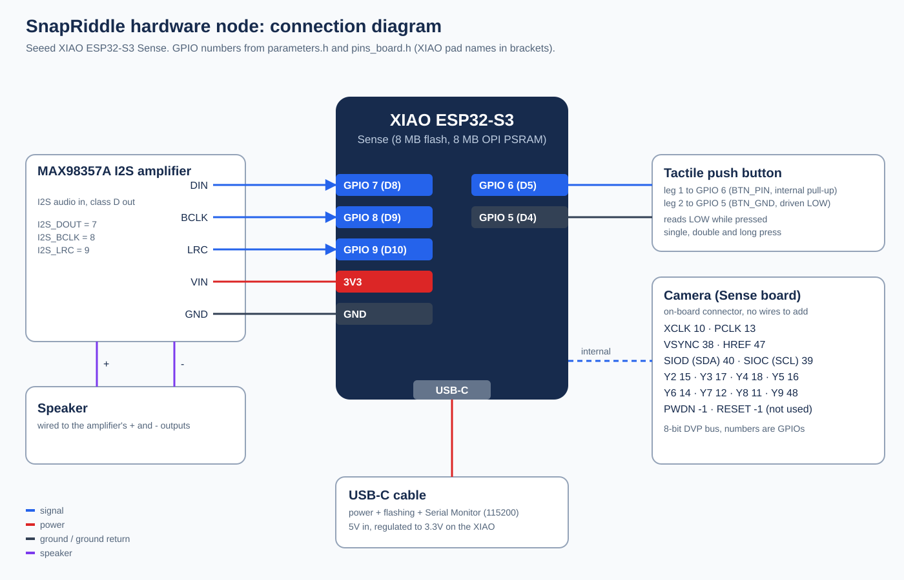

# ESP32 pin mapping

The board is a Seeed XIAO ESP32-S3 Sense. GPIO numbers below are ESP32 GPIO identifiers, with the XIAO pad name in brackets. Every constant comes from [parameters.h](../../ESP32/SnapRiddle_HW/parameters.h) or [pins_board.h](../../ESP32/SnapRiddle_HW/pins_board.h).

## Wired by hand

Direction is relative to the ESP32.

| ESP32 GPIO | Direction | Connected to | Firmware constant | Purpose |
| --- | --- | --- | --- | --- |
| 7 (D8) | Output, I2S data | MAX98357A DIN | `I2S_DOUT` | Audio samples |
| 8 (D9) | Output, I2S clock | MAX98357A BCLK | `I2S_BCLK` | Bit clock |
| 9 (D10) | Output, I2S word select | MAX98357A LRC | `I2S_LRC` | Left/right clock |
| 6 (D5) | Input, internal pull-up | Push button, leg 1 | `BTN_PIN` | Reads LOW while pressed |
| 5 (D4) | Output, held LOW | Push button, leg 2 | `BTN_GND` | Ground return for the button |
| 3V3 | Power | MAX98357A VIN | - | Amplifier supply (3.3V) |
| GND | Ground | MAX98357A GND | - | Common ground |

The speaker connects to the amplifier's + and - output terminals, not to the ESP32. Power, flashing and the Serial Monitor (115200 baud) all go through the XIAO's USB-C port. USB supplies 5V, and the XIAO's regulator turns it into the 3.3V on its 3V3 pin, which powers the amplifier.

Driving GPIO 5 LOW gives the button a ground on the pin right next to GPIO 6, so the button needs no separate GND wire. The same wiring is used in the `Button_test` unit test.

## Camera (on the Sense expansion board)

The camera plugs into the Sense board's connector, so there is nothing to wire. These are the GPIOs the firmware configures in `camInit()`:

| Signal | GPIO | Constant |
| --- | --- | --- |
| XCLK | 10 | `XCLK_GPIO_NUM` |
| PCLK | 13 | `PCLK_GPIO_NUM` |
| VSYNC | 38 | `VSYNC_GPIO_NUM` |
| HREF | 47 | `HREF_GPIO_NUM` |
| SIOD (SCCB SDA) | 40 | `SIOD_GPIO_NUM` |
| SIOC (SCCB SCL) | 39 | `SIOC_GPIO_NUM` |
| D0 to D7 (Y2 to Y9) | 15, 17, 18, 16, 14, 12, 11, 48 | `Y2_GPIO_NUM` to `Y9_GPIO_NUM` |
| PWDN, RESET | not connected (-1) | `PWDN_GPIO_NUM`, `RESET_GPIO_NUM` |

Frames are stored in the 8 MB OPI PSRAM, which is why the Arduino IDE setting PSRAM = OPI PSRAM is required.

## Not used

The XIAO's on-board LED is not used: it cannot be seen in party lighting. The serial console and the web app show the board's status instead (see the [user guide](../USER_GUIDE.md#statuses)).
